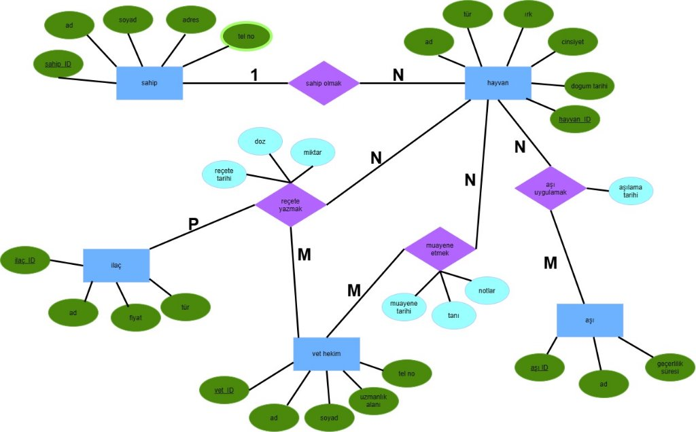

# VetDataBase

**Proje No 25 — Veteriner Kliniği Yönetim Sistemi** 

---

## Ekip Üyeleri

| Öğrenci No | Ad Soyad |
| :--- | :--- |
| **032490018** | Mehmet Berke Terzi |
| **032490036** | Oğuzhan Malkoç |
| **032490052** | Yağızhan Burak Yakar |
| **032490067** | Mehmet Oğuzhan Tanrıverdi |

---

## Proje Senaryosu

> Evcil hayvan sahiplerinin benzersiz bir kimlik numarası, adı, soyadı, adresi ve birden fazla telefon numarası vardır. Her hayvan sahibinin birden fazla evcil hayvanı olabilir. Evcil hayvanların benzersiz bir numarası, adı, türü, ırkı, cinsiyeti ve doğum tarihi bulunur. Veteriner hekimlerin benzersiz bir kimlik numarası, adı, soyadı, uzmanlık alanı ve telefon numarası vardır. Veteriner hekimler evcil hayvanları muayene eder. Her muayene için muayene tarihi, tanı ve notlar kaydedilir. Veteriner hekimler evcil hayvanlara ilaç reçete edebilir. Her ilacın benzersiz bir numarası, adı, türü ve birim fiyatı vardır. Reçete edilen her ilaç için reçete tarihi, doz ve miktar bilgisi kaydedilir. Evcil hayvanlara ayrıca aşı uygulanabilir. Her aşının benzersiz bir numarası, adı ve geçerlilik süresi vardır. Bir evcil hayvana uygulanan her aşı için aşılama tarihi kaydedilir.

---

## 1. Varlık-İlişki (E-R) Diyagramı

### Diyagram Özeti
* **Güçlü Varlıklar (5 Adet):** `sahip`, `hayvan`, `vet hekim`, `ilaç`, `aşı`
* **Çok Değerli Nitelik:** `sahip` varlığına ait `tel no` (Bir hayvan sahibinin birden fazla telefon numarası olabilir)
* **İlişkiler ve Kardinaliteler:**
  * `sahip olmak` (`sahip` 1 — N `hayvan`): 1:N ilişki
  * `muayene etmek` (`vet hekim` M — N `hayvan`): M:N ilişki (`muayene tarihi`, `tanı`, `notlar`)
  * `aşı uygulamak` (`hayvan` N — M `aşı`): M:N ilişki (`aşılama tarihi`)
  * `reçete yazmak` (`vet hekim` M — N `hayvan` — P `ilaç`): M:N:P ilişki (`reçete tarihi`, `doz`, `miktar`)

---

## 2. İlişkisel Veritabanı Şeması 

7 Adımlı E-R'den İlişkisel Modele Dönüşüm Algoritması sonucunda elde edilen **9 ilişkisel tablo**:

| # | Tablo Adı | Birincil Anahtar (PK) | Yabancı Anahtarlar (FK) | Diğer Nitelikler (Sütunlar) | Dönüşüm Adımı |
| :-: | :--- | :--- | :--- | :--- | :--- |
| **1** | **Sahip** | `sahip_ID` | - | `ad`, `soyad`, `adres` | Adım 1 (Güçlü Varlık) |
| **2** | **Sahip_Telefon** | `(sahip_ID, tel_no)` | `sahip_ID` → `Sahip(sahip_ID)` | - | Adım 6 (Çok Değerli Nitelik) |
| **3** | **Hayvan** | `hayvan_ID` | `sahip_ID` → `Sahip(sahip_ID)` | `ad`, `tur`, `irk`, `cinsiyet`, `dogum_tarihi` | Adım 1 & Adım 4 (1:N İlişki) |
| **4** | **Veteriner_Hekim** | `vet_ID` | - | `ad`, `soyad`, `uzmanlik_alani`, `tel_no` | Adım 1 (Güçlü Varlık) |
| **5** | **Ilac** | `ilac_ID` | - | `ad`, `tur`, `fiyat` | Adım 1 (Güçlü Varlık) |
| **6** | **Asi** | `asi_ID` | - | `ad`, `gecerlilik_suresi` | Adım 1 (Güçlü Varlık) |
| **7** | **Muayene** | `(hayvan_ID, vet_ID, muayene_tarihi)` | `hayvan_ID` → `Hayvan(hayvan_ID)` `vet_ID` → `Veteriner_Hekim(vet_ID)` | `tani`, `notlar` | Adım 5 (M:N İlişki) |
| **8** | **Asi_Uygulama** | `(hayvan_ID, asi_ID, asilama_tarihi)` | `hayvan_ID` → `Hayvan(hayvan_ID)` `asi_ID` → `Asi(asi_ID)` | - | Adım 5 (M:N İlişki) |
| **9** | **Recete** | `(hayvan_ID, vet_ID, ilac_ID, recete_tarihi)` | `hayvan_ID` → `Hayvan(hayvan_ID)` `vet_ID` → `Veteriner_Hekim(vet_ID)` `ilac_ID` → `Ilac(ilac_ID)` | `doz`, `miktar` | Adım 7 (Üçlü / n-ary İlişki) |

